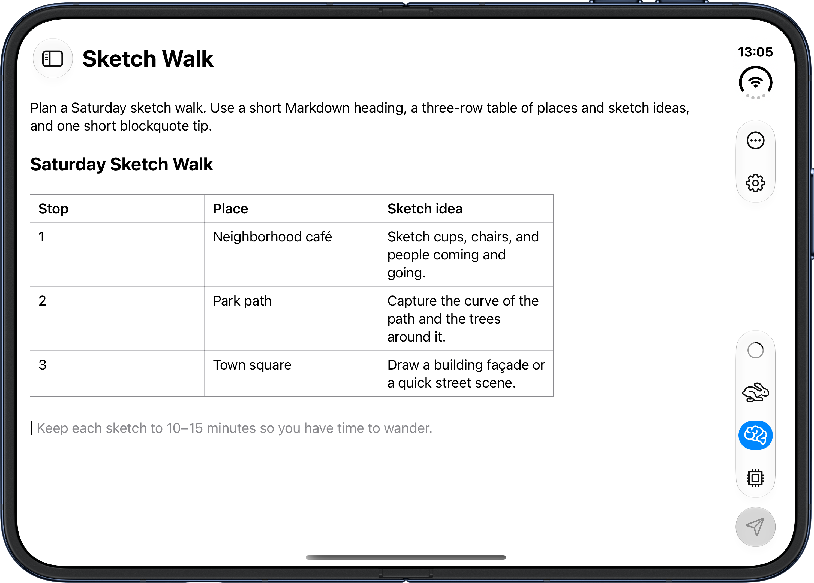

# Supernova

Supernova is a native SwiftUI app for drafting and continuing conversations with OpenAI. Replies stream into the editor alongside your text, with Markdown tables and images rendered inline.



*A live OpenAI Responses API reply on the iPhone Duo simulator, framed with `frames-cli`.*

## What you can do

- Create, rename, switch between, and delete locally saved conversations. Each conversation has its own draft.
- Send multi-turn requests and stop a streaming reply. Choose the model and configure its reasoning effort from the editor toolbar.
- Read Markdown headings, lists, links, quotes, and code, with native inline views for tables and HTTPS images.

The context ring shows the latest token total reported by the Responses API for each conversation, relative to the context window of the model used for that request. The ring starts empty until a request reports usage.

Fast Mode requests faster processing at [OpenAI’s Fast Mode rates](https://developers.openai.com/api/docs/guides/fast-mode). It starts off and is available only for supported models. The setting applies to both new messages and retries.

The app targets iOS, macOS, and visionOS. The iPhone Duo simulator is the primary UI test destination.

## Get started

You need Xcode 27.2 with the SDK for your destination, Swift Package Manager access to the declared dependencies, and an OpenAI API key with access to your chosen model. The deployment targets are iOS 27.2, macOS 27.2, and visionOS 27.2.

1. Clone the repository and open `Supernova.xcodeproj` in Xcode.
2. Select the **Supernova** scheme and a compatible simulator. If running on a physical device, select your own team and use a unique bundle identifier in **Signing & Capabilities**.
3. Run the app, choose **New Thread**, then open **Config** and enter your API key. Tap outside the field to save it.
4. Return to the editor, type a message, and choose **Send**.

The API key is stored in Keychain. Messages and drafts are saved on the device. OpenAI receives the prompt and conversation history when you send a message. Remote images are loaded from the HTTPS URLs in replies.

## Build and test

```sh
xcodebuild -project Supernova.xcodeproj -scheme Supernova \
  -destination 'generic/platform=iOS Simulator' CODE_SIGNING_ALLOWED=NO build
xcrun simctl list devices available
xcodebuild -project Supernova.xcodeproj -scheme Supernova \
  -destination 'platform=iOS Simulator,id=SIMULATOR_UDID' \
  CODE_SIGNING_ALLOWED=YES CODE_SIGN_IDENTITY=- test
```

Replace `SIMULATOR_UDID` with the ID of your iPhone Duo simulator. The test suite uses isolated storage and does not require an OpenAI API key.

## Contributing and license

See [CONTRIBUTING.md](CONTRIBUTING.md) for the development workflow and [SECURITY.md](SECURITY.md) for vulnerability reports.

Supernova is licensed under the [MIT License](LICENSE). Swift Package Manager dependencies use their own licenses, including [OpenAI](https://github.com/MacPaw/OpenAI), [SwiftUI Introspect](https://github.com/siteline/swiftui-introspect), and [ThinkingOrbs](https://github.com/haplollc/ThinkingOrbs).
